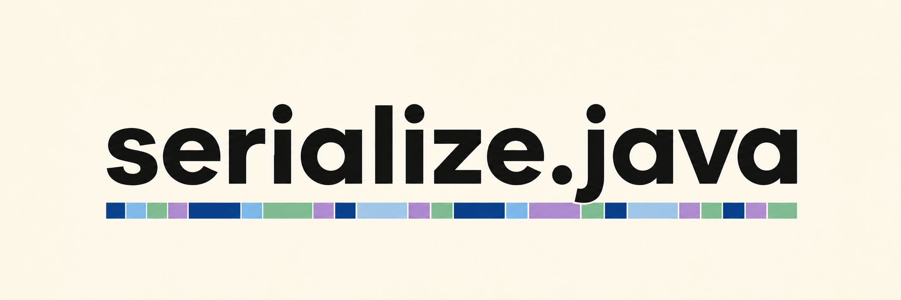

# serialize.java



A bitpacking serialization library for **Java**. Part of the serialize
family, wire compatible with the
[C++](https://github.com/mas-bandwidth/serialize),
[C](https://github.com/mas-bandwidth/serialize.c),
[Go](https://github.com/mas-bandwidth/serialize.go),
[C#](https://github.com/mas-bandwidth/serialize.cs),
[Rust](https://github.com/mas-bandwidth/serialize.rs),
[JavaScript](https://github.com/mas-bandwidth/serialize.js),
[Dart](https://github.com/mas-bandwidth/serialize.dart) and
[Elixir](https://github.com/mas-bandwidth/serialize.elixir) libraries —
the same values produce the same bytes in every implementation, so a
stream written by one reads in any other.
[STANDARD.md](STANDARD.md) — a verbatim vendored copy of the
specification in
[mas-bandwidth/serialize](https://github.com/mas-bandwidth/serialize),
which CI checks for drift — is the authority on every byte.

Version 1.2.0 (`SerializeUtil.VERSION`).

If this library helps you, **[please support it](https://www.patreon.com/MasBandwidth/membership)**

## Getting it

serialize.java ships as source today. The implementation is ready and the
package is not yet published: there is no artifact on Maven Central under any
coordinate, and there is no Maven or Gradle build here to produce one.
Publishing it is a separate round.

Seventeen files under `src/serialize/`, zero dependencies, Java 17 language
level. Take it either way:

**Copy the package in** — drop `src/serialize/` into your own source tree and
it compiles with the rest of it, no build changes at all.

**Build a jar** — the same javac line the Makefile uses, against any JDK 17 or
newer:

```sh
git clone https://github.com/mas-bandwidth/serialize.java.git
javac --release 17 -d classes serialize.java/src/serialize/*.java
jar cf serialize.jar -C classes serialize
```

then compile and run against it with `-cp serialize.jar`. Write-side contracts
are `assert` statements, so run with `-ea` while developing and without it in
release — the two shapes the test suite covers.

Pin a release tag rather than tracking `main`. The newest is on the
[releases page](https://github.com/mas-bandwidth/serialize.java/releases): a
release states a format version, and two endpoints interoperate only when they
carry the same one.

## The surface

One package, `serialize`, zero dependencies. The complete family
operation set on three streams — `WriteStream`, `ReadStream` and
`MeasureStream` — sharing the `BitStream` interface, so a single
serialize function writes, reads and measures. Values travel in
primitive-specialized holder cells (`IntRef`, `LongRef`, `BoolRef`,
`FloatRef`, `DoubleRef`) that keep the hot path free of boxing, and in
`Ref<T>` for object values (`String`, the 128-bit pair).
[USAGE.md](USAGE.md) teaches every operation by example.

- **Raw bits**: `serializeBits` (1–32), `serializeBits64` (1–64),
  `serializeAlign`.
- **Ranged integers**: `serializeInt`, `serializeInt64`,
  `serializeInt128` — offset from min in exactly the bit length of the
  range, unsigned-domain arithmetic so ranges wider than 2^63/2^127 are
  exact, zero bits for a degenerate `min == max` range on every width.
- **Unsigned helpers and bool**: `serializeUint8` / `16` / `32` / `64`,
  `serializeUint128` (the `UInt128Value` pair), `serializeBool`.
- **Floats**: `serializeFloat` and `serializeDouble`, finite values
  only, every finite pattern bit exact both ways (-0 and the subnormals
  included), NaN and the infinities refused on read;
  `serializeCompressedFloat`, quantizing in float32 with the standard's
  two roundings on each side, a non-finite decode refused.
- **Bytes and strings**: `serializeBytes` (aligned bulk copy, count
  agreed, not transmitted); `serializeString` (UTF-8 on the wire, an
  embedded NUL and malformed UTF-8 refused on read in every mode, decoded
  strictly, real text round tripped byte for byte).
- **The end**: `serializeEnd`, read after the last field of a packet's
  top-level object — a whole byte left over is refused as
  `trailing_data`, a set bit in the final byte's padding as
  `nonzero_padding`. A writer's end emits nothing.
- **Refusal reasons**: `ReadStream.getRefusal()` names the first
  refusal from the standard's closed list (`Refusal`, spelled
  `past_end`, `value_out_of_range`, `nonzero_padding`, `trailing_data`,
  `non_finite_float`, `invalid_utf8`, `embedded_nul`, `non_canonical`).
- **The relative integer**: `serializeIntRelative` — the flag ladder for
  strictly increasing sequences over the domain 0 to 2^31 - 1, one bit
  for a difference of 1, every tier's reconstruction checked on read,
  and the absolute tier refused as `non_canonical` when it carries a
  difference a bounded tier would have taken.
- **Fixed point**: `serializeFixed` at 8/16/32/64-bit storage and
  `serializeFixed128` at 128-bit storage — Q formats, the raw scaled
  integer as an exact ranged offset, byte identical to `serializeInt64`
  wherever storage fits 64 bits.
- **128-bit values**: `Int128Value` / `UInt128Value`, two's complement
  pairs of long halves, mirroring the family's emulated pair types.
- **Utilities**: `SerializeUtil` — `bitsRequired` / `64` / `128`, zig-zag
  conversion, the compressed-float step count.
- **Composition**: `serializeObject`, which runs a nested `Serializer`
  inline and contributes no bytes of its own — no framing, no length
  prefix, no alignment inserted around it.
- **The bitpacker underneath**: `BitWriter` and `BitReader`, the family
  wire in branchless 64-bit window loads. Every stream and both
  bitpackers expose `reset(...)` for allocation-free reuse.

## Quick example

```java
import serialize.*;

final class Player
{
    final IntRef health = new IntRef();
    final BoolRef alive = new BoolRef();
    final FloatRef heading = new FloatRef();
}

static boolean serializePlayer( BitStream stream, Player player )
{
    return stream.serializeInt( player.health, 0, 100 )
        && stream.serializeBool( player.alive )
        && stream.serializeFloat( player.heading );
}

byte[] buffer = new byte[64];                        // length a multiple of 8
WriteStream writer = new WriteStream( buffer, buffer.length );
serializePlayer( writer, player );                   // -> true
writer.flush();                                      // always flush before touching the bytes
int packetBytes = (int) writer.getBytesProcessed();  // 5 bytes: 7 + 1 + 32 bits

ReadStream reader = new ReadStream( buffer, packetBytes );
boolean ok = serializePlayer( reader, decoded )      // -> true
          && reader.serializeEnd();                  // a packet ends where its object does
```

## Toolchain

The JDK is pinned per project, not taken from the system:
[tending/PINS.md](tending/PINS.md) records the exact version, download
URL and SHA-256. `dist/` is gitignored — re-fetch by the pinned URL,
verify the hash, and unpack so the JDK sits at
`dist/jdk-21.0.12.1/Contents/Home`. The library targets the Java 17
language level (`javac --release 17`), built and tested on the pinned
JDK 21. A plain Makefile drives everything — no Maven, no Gradle:

```
make          # all three below
make test          # the suite with assertions on, the checked shape
make test-release  # the same suite with assertions off, the release shape
make controls      # the negative controls: sabotaged readers must fail exactly their rule's vectors
```

## Testing

`make test` runs the suite with assertions enabled (`-ea`): writer
contracts are `assert` statements, so this is the checked shape.
`make test-release` runs the same suite with assertions disabled — the
release shape, where asserts compile to nothing at runtime, matching the
C++ library's `serialize_assert` under `NDEBUG` — which is what proves
the read side's refusals are checks rather than asserts. Both are CI
gates.

The suite runs every vector in [`conformance/`](conformance), the
family's shared corpus, vendored from mas-bandwidth/serialize and
checked for drift by CI. The directory is discovered at run time rather
than named in the source, and a vector whose operation the runner cannot
drive fails rather than being skipped. An accepted vector must decode to
the stated value and consume the stated bits; a vector marked
`writer = canonical` is re-emitted through the write stream and compared
byte for byte, flush included; a vector carrying `measure_at_least` is
held to that floor on the measure stream; a vector carrying
`writer_input` hands the writer that float and requires the record's
bytes. A refused vector must be refused for the reason it states, must
leave the caller's scalar destination unwritten, and must leave the
stream terminal, which is checked by behavior: every later step refuses
too, and a further read fails, consumes no bits and writes nothing.
Nothing regenerates its own expectations. The suite also pins the
family's golden vectors byte for byte — the golden wire message covering
every operation class and its end, the discriminating compressed-float
vectors (bit patterns, not tolerances), the string pins, every
relative-integer tier, and the fixed point shapes at every group count —
plus a sabotage sweep proving every bit of the golden stream is load
bearing, its padding included, refusal and terminality proofs for hostile
input, and the measure bound.

`make controls` proves the corpus responds. A vector whose operation has
no runner must turn the run red, and for each refusal rule a reader with
that one rule deleted — a string replacement in a scratch copy of the
library, compiled and loaded on its own — must fail exactly the vectors
[`conformance-controls/`](conformance-controls)`<rule>.expected` names,
the same lists the reference holds its own sabotaged readers to.

[`interop/`](interop) takes it further: the CI `interop` job builds the
C++ reference at a pinned release and runs it head to head with this
port. Both halves write the same boundary message — every operation the
standard defines, at its boundary values — and the files must be byte
identical; each then decodes the other's bytes and re-encodes them
exactly; both must refuse every truncation of the other's stream, and the
stream one byte longer; and both run the corpus. The release candidate in this repository exchanges
bytes with the reference on every push, so wire compatibility is
measured rather than asserted. `make interop MODE=write FILE=out.bin`
runs one exchange by hand.

Benchmarking for the serialize family lives in [mas-bandwidth/schema](https://github.com/mas-bandwidth/schema)'s data-driven bench, which measures the generated codecs across every language on one corpus.

## License

[BSD 3-Clause](LICENSE), © Más Bandwidth LLC.
